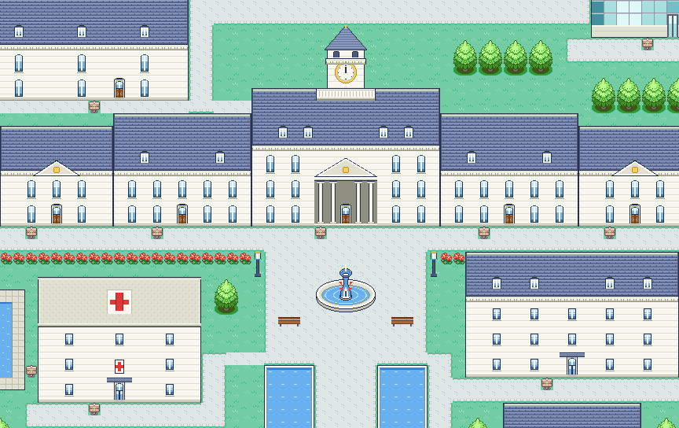
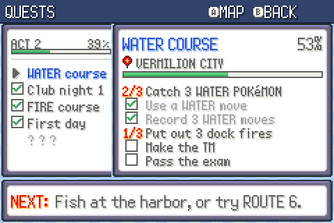
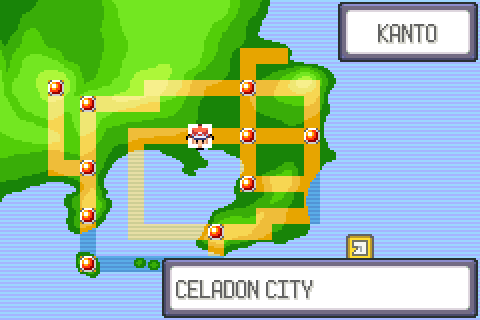
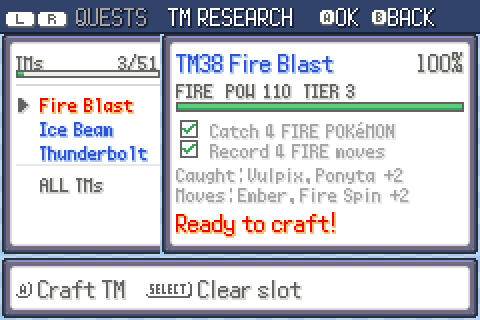

# Pokémon Unnamed (working title)

A Pokémon ROM hack for the Game Boy Advance, set in Kanto and built on the FireRed mode of
[`pokeemerald-expansion`](https://github.com/rh-hideout/pokeemerald-expansion).

## Overview

The game follows an ordinary person's life with Pokémon in three acts, each longer than the one before.

- **Act 1, Childhood.** The player grows up on a farm near a small town, with no training and no Poké Balls. The
  player must learn to befriend the local Pokémon without battling.
- **Act 2, University.** The player attends university, where Poké Balls and 3v3 battles are introduced.
- **Act 3, Workforce.** The player starts a career at Silph Co.

## Features added by this hack

### New locations

- **Act 1:** a farm just west of Pallet Town, with the player's farmhouse, a barn and a farmyard, and the Woods
  beyond it.
- **Act 2:** Celadon University, north of Celadon City through a gate building. It's drawn with its own tiles after
  the Tamamushi University lore art: white stone halls around a clock tower and a Gyarados fountain, a glass
  greenhouse, a stadium, a hospital and pool, a glass Science Institute tower, and student dorms, all in a forest.
  Every building has its own interior.

  

- **Act 3:** none yet.

### Befriending (Act 1)


In Act 1 the player cannot attack or catch Pokémon. A befriending battle replaces the wild battle: the player
chooses actions (such as holding out a hand or crouching down), offers items, or watches the Pokémon for hints.
Each Pokémon reacts differently to each action and item. The bar under its name shows its aggression, and the
Pokémon is befriended when it reaches zero. Every choice uses up some of its patience (the pips next to its name);
when it runs out, the Pokémon runs away.

One befriended Pokémon follows the player at a time. The others live in a farmyard at the player's house.

### 3v3 battles (Act 2 on)

 

Each side has three Pokémon on the field, but only one Pokémon per side acts each turn. The player picks which one
with L and R, then its move and target. Each turn starts on the Pokémon that acted last.

Each side's three Pokémon stand in a formation: front, middle and back (from right to left on screen). Pressing
SELECT moves the chosen Pokémon forward in the formation, which does not use up the turn. At the start of a battle
the formation follows the party order: the first Pokémon is in front.

Moves are either direct or indirect:

- A **direct** attack travels out from the user or makes contact, so it hits the front Pokémon, which blocks the
  others. Tackle is a direct attack.
- An **indirect** attack can be aimed at any of the three Pokémon. Electric, Psychic and Flying moves, sound moves
  and attacks from above or below are indirect. Thunder Shock is an indirect attack.

A move hits one, two or all three Pokémon. With two targets, the second takes half damage; with three, each takes
75%.

**The move badge.** In the move menu, the move's type moves up beside its PP, and the line below shows how the
selected move reaches its targets and how many Pokémon it hits:


- **DIRECT** (red): hits the front Pokémon, which blocks the others.
- **INDIRECT** (blue): can be aimed at any of the Pokémon.
- **ALL** (dark): hits every Pokémon on the other side.
- **x1, x2, x3:** how many Pokémon the move hits.

After choosing a move that hits two or three Pokémon, they flash and the player confirms with A (B goes back).

The floor under each team is drawn in the style of the terrain's own battle platforms: the same colors, texture and
rim as in a normal battle on that terrain.

When each side has only two Pokémon, the same rules apply with two Pokémon per side.

### University courses (Act 2)

Each course (Fire, Water, Grass) is a field trip with a research sheet: catch three different Pokémon of the type,
use and record moves of the type, and solve a puzzle at the site using a Pokémon of the type. Completing the sheet
lets the player make the course's TM (reusable, as are all TMs) and take the course exam.

### The friends' families (Act 2 on)

Each of the player's university friends has a family home in Kanto, with parents who are always in and who talk
about their kid as the story goes on.

### Quests (Acts 2 and 3)

 

QUESTS in the pause menu lists the act's quests: the current one first, then the finished ones. The selected
quest shows its tasks with checkboxes and counters, a completion percentage, where to go, and the next step.
A opens the map, where the current quest's place blinks. It blinks on the Town Map item too.



**TM Research.** Later on, research becomes the main way to get new TMs: pick up to three TMs to research (one per
type), then catch different Pokémon of the TM's type and record different moves of it in battle. Stronger moves need
more. The TM RESEARCH tab (L/R in QUESTS) tracks each one and crafts it when it's done. Catch 25 different Pokémon of
a type and all of its TMs are yours.

### A Kanto of its own

The base game's story is gone from Kanto: no rival encounters, no Team Rocket blocking roads, and nobody calls the
player "champ". The people of Kanto talk about their own lives instead.

Where the story sends the player across the region, trainers and wild Pokémon are leveled to match: each area's
levels are set the first time the player arrives and stay put after that, so coming back stronger pays off.
Pokémon from other regions turn up in the wild and on trainers' teams.

### Custom dungeons

Not every place in this Kanto is on the map. Some are built from scratch for this hack, with puzzles that put the
player's Pokémon knowledge to the test.

### A new move

Somewhere along the way, a brand-new move is invented, one no Pokémon game has had before.

### Key items (Acts 2 and 3)

- **Remote Desktop:** opens the Pokémon Storage System from anywhere.
- **Heal Dash:** returns the player to the last Pokémon Center they visited.

  While it's part of the challenge of pokemon games to properly prepare for journeys many users (myself included)
  prefer to just walk back to the pokemon centers to reset. The game punishes you for this by making you walk both
  ways (back and forth) but I'm lessening the pain by only making you do one direction with a warp back to the latest
  pokemon center always available to you in Key Items.

### Speed

I typically play most pokemon games and rom hacks with fast forward enabled but I find I miss the atmosphere from
the audio. I've tweaked the default walk/run/animation/text speeds to roughly match a 2x emulation speed while preserving
the audio. Hopefully best of both worlds.

- **Walking:** the player walks at 1.5x the usual speed.
- **Running:** holding B runs from the start of the game (no Running Shoes needed), at 1.5x the faster walk.
- **Battles:** battles, including their animations and the transition into them, run at 1.5x. Sound and music stay
  at their usual pace.
- **Text:** all text prints at 3x, whatever the text speed option.

Scripted scenes in the overworld play at the usual speed, so characters keep in step.

## Status

- **Act 1:** complete.
- **Act 2:** in playtesting.
- **Act 3:** not started.

Design notes for the acts and the custom systems are in [`docs/hack/`](docs/hack/).

## Building

The hack builds the same way as `pokeemerald-expansion`; see [`INSTALL.md`](INSTALL.md) for the toolchain setup.
No game ROM is included or needed to build.

```
make               # pokemon-unnamed.gba
make act2          # pokemon-unnamed-act2.gba, a playtest build that starts at the beginning of Act 2
make check         # the test suite
```

## Credits

This project is based on [RHH's `pokeemerald-expansion`](https://github.com/rh-hideout/pokeemerald-expansion), which
is built on [pret's `pokeemerald`](https://github.com/pret/pokeemerald) decompilation project.

```
Based off RHH's pokeemerald-expansion 1.17.2 https://github.com/rh-hideout/pokeemerald-expansion/
```

See [`CREDITS.md`](CREDITS.md) for the contributors to `pokeemerald-expansion`.

## About `pokeemerald-expansion`

`pokeemerald-expansion` is a GBA ROM hack base built on top of pret's `pokeemerald`. Its feature list is in
[`FEATURES.md`](FEATURES.md) and its documentation is at
[rh-hideout.github.io/pokeemerald-expansion](https://rh-hideout.github.io/pokeemerald-expansion/). Questions and
bug reports about the base itself belong with the
[RHH project](https://github.com/rh-hideout/pokeemerald-expansion) and its
[Discord server](https://discord.gg/6CzjAG6GZk).
