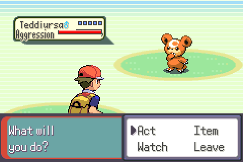
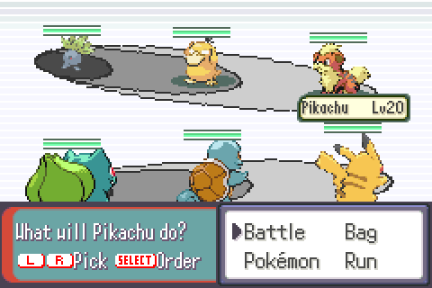
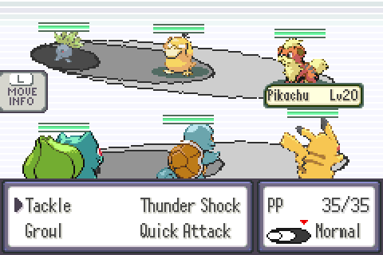
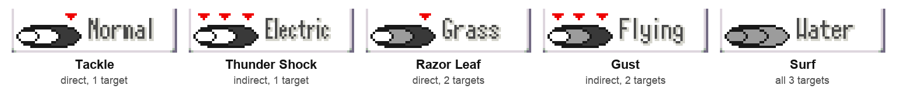

# Pokémon Unnamed (working title)

A Pokémon ROM hack for the Game Boy Advance, set in Kanto and built on the FireRed mode of
[`pokeemerald-expansion`](https://github.com/rh-hideout/pokeemerald-expansion).

## Overview

The game follows an ordinary person's life with Pokémon in three acts, each longer than the one before.

- **Act 1, Childhood.** The player grows up on a farm near a small town, with no training and no Poké Balls.
  Pokémon are befriended rather than caught or battled. The player befriends Pokémon in the woods near home, the
  last of them an aggressive Jangmo-o, after which Professor Oak offers them a place at university.
- **Act 2, University.** The player attends Celadon University. Poké Balls and teams of up to three are introduced,
  along with 3v3 battles in which each side chooses one of its three Pokémon to act each turn. The act is organized
  around three courses (Fire, Water and Grass), each with a field trip, a research assignment, a TM and an exam, and
  ends with a final research project.
- **Act 3, Workforce.** The player works as a researcher at Silph Co. and investigates an employee who is passing
  information to Team Rocket. This act revisits events from FireRed, including Team Rocket's takeover of Silph Co.,
  from the point of view of someone working there.

## Features added by this hack

### Befriending (Act 1)



In Act 1 the player cannot attack or catch Pokémon. A befriending battle replaces the wild battle: the player
chooses actions (such as holding out a hand or crouching down), offers items, or watches the Pokémon for hints.
Each Pokémon reacts differently to each action and item. The bar under its name shows its aggression, and the
Pokémon is befriended when it reaches zero. Every choice uses up some of its patience (the pips next to its name);
when it runs out, the Pokémon runs away.

One befriended Pokémon follows the player at a time. The others live in a farmyard at the player's house.

### 3v3 battles (Act 2 on)

 

Each side has three Pokémon on the field, but only one Pokémon per side acts each turn. The player picks which one
with L and R, then its move and target.

Each side's three Pokémon stand in a formation: front, middle and back (from right to left on screen). Pressing
SELECT moves the chosen Pokémon forward in the formation, which does not use up the turn. At the start of a battle
the formation follows the party order: the first Pokémon is in front.

Moves are either direct or indirect:

- A **direct** attack travels out from the user or makes contact, so it hits the front Pokémon, which blocks the
  others. Tackle is a direct attack.
- An **indirect** attack can be aimed at any of the three Pokémon. Electric, Psychic and Flying moves, sound moves
  and attacks from above or below are indirect. Thunder Shock is an indirect attack.

A move hits one, two or all three Pokémon. With two targets, the second takes half damage; with three, each takes
75%.

**The move indicator.** In the move menu, next to the move's type, a small copy of the opponents' formation shows
what the selected move does: the back Pokémon on the left, the front Pokémon on the right.



- **Shading:** dark is full damage, gray is reduced damage, white is not hit.
- **Red arrows:** where the move can be aimed. One arrow over the front Pokémon for a direct attack; arrows over
  all three for an indirect attack. Moves that hit all three have no arrows.

When each side has only two Pokémon, the same rules apply with two Pokémon per side.

### University courses (Act 2)

Each course (Fire, Water, Grass) is a field trip with a research sheet: catch three different Pokémon of the type,
use and record moves of the type, and solve a puzzle at the site using a Pokémon of the type. Completing the sheet
lets the player make the course's TM, and the course exam only counts if the TM's move is used.

### Key items (Acts 2 and 3)

- **Remote Desktop:** opens the Pokémon Storage System from anywhere.
- **Heal Dash:** returns the player to the last Pokémon Center they visited.

## Status

- **Act 1:** complete.
- **Act 2:** in playtesting.
- **Act 3:** not started.

Design notes for the acts and the custom systems are in [`docs/hack/`](docs/hack/).

## Building

The hack builds the same way as `pokeemerald-expansion`; see [`INSTALL.md`](INSTALL.md) for the toolchain setup.
No game ROM is included or needed to build.

```
make               # pokemon-unnamed.gba
make act2          # pokemon-unnamed-act2.gba, a playtest build that starts at the beginning of Act 2
make check         # the test suite
```

## Credits

This project is based on [RHH's `pokeemerald-expansion`](https://github.com/rh-hideout/pokeemerald-expansion), which
is built on [pret's `pokeemerald`](https://github.com/pret/pokeemerald) decompilation project.

```
Based off RHH's pokeemerald-expansion 1.17.2 https://github.com/rh-hideout/pokeemerald-expansion/
```

See [`CREDITS.md`](CREDITS.md) for the contributors to `pokeemerald-expansion`.

## About `pokeemerald-expansion`

`pokeemerald-expansion` is a GBA ROM hack base built on top of pret's `pokeemerald`. Its feature list is in
[`FEATURES.md`](FEATURES.md) and its documentation is at
[rh-hideout.github.io/pokeemerald-expansion](https://rh-hideout.github.io/pokeemerald-expansion/). Questions and
bug reports about the base itself belong with the
[RHH project](https://github.com/rh-hideout/pokeemerald-expansion) and its
[Discord server](https://discord.gg/6CzjAG6GZk).
